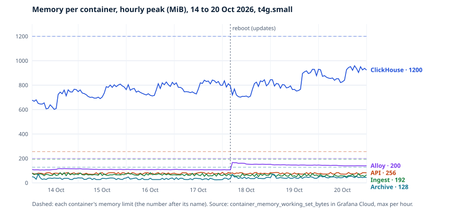

# Benchmarks

What the API's and ingest's queries cost at full retained volume, and what the stack costs while it runs. Rerun the first part with `make bench`; it uses its own database (`demos_bench`) and leaves the stack's data alone.

## Queries at 7 days of data

### Setup

- **Data:** exactly 7 days of synthetic edits at 11 a second, twice the live rate measured on 2026-10-04 (en 3.6/s, de 1.0/s, pt 0.9/s): 6.65 million rows, 296 MB compressed. Language mix, bot share and a skewed title distribution follow the live stream.
- **Limits:** the `api` profile's limits (2 threads, 200 MB, 3 s) applied to every query as query settings, including the whole-snapshot timing. The benchmark connects as admin, because the `api` user can only read the real `demos` database; the other `api` constraints (read-only, settings can't be raised) are tested separately in `test_application_users_cant_exceed_their_role`.
- **Runs:** 20 per query. Timing and rows read are ClickHouse's own; peak memory is from `system.query_log`.
- **Machine:** an Apple Silicon laptop, ClickHouse 25.8 in Docker under the stack's 1.2 GB container limit and `clickhouse/config.d/low-memory.xml`. Not the production instance (a t4g.small has 2 vCPUs).

### Results, 2026-10-05

| Query | p50 ms | p95 ms | Rows read | Peak memory |
|---|---:|---:|---:|---:|
| snapshot: newest event | 0.6 | 0.9 | 41 | 4.2 MB |
| snapshot: 5 min totals | 2.0 | 2.6 | 23,227 | 4.2 MB |
| snapshot: top articles | 2.2 | 2.4 | 23,227 | 4.2 MB |
| snapshot: per minute (rollup + current minute from raw) | 1.7 | 41.2 | 32,279 | 4.2 MB |
| snapshot: ingest lag | 1.4 | 1.9 | 24,619 | 4.4 MB |
| snapshot: recent gaps | 0.4 | 1.2 | 0 | 3.1 MB |
| query it: 1 h, all langs | 6.7 | 8.2 | 57,387 | 5.8 MB |
| query it: 24 h, all langs | 71.8 | 1,659.1 | 975,019 | 75.4 MB |
| resume: max ingest_seq | 2.7 | 4.0 | 176 | 4.2 MB |
| resume: last 20k by ingest order | 6.1 | 13.1 | 41,003 | 23.7 MB |

- Whole snapshot build, five queries at once: p50 10 ms, p95 15 ms.
- Insert throughput, 5,000-row JSON batches through the rollup view (ingest's own write path): about 140,000 rows a second. Catching up an hour's outage (about 20,000 rows) takes well under a second of insert time; the stream's replay speed is the limit.
- The p95 column is noisy: the queries run while ClickHouse is still merging the freshly loaded data. An earlier run put the 24 h p95 at 776 ms. Both are inside the 3 s limit.

### 3 and 7 days, 2026-10-08

The same benchmark (7 days at 11 edits/s, twice the live rate: 6,652,800 raw rows), on ClickHouse 26.8, after migration 0004 added the per-minute page sets. 20 runs each, with the `api` user's limits.

| Query | p50 ms | p95 ms | Rows read | Peak memory |
|---|---:|---:|---:|---:|
| query it: 24 h, all langs (raw rows) | 148.4 | 214.4 | 975,963 | 52.7 MB |
| query it: 3 days, all langs (page sets) | 127.4 | 162.8 | 44,003 | 76.0 MB |
| query it: 7 days, all langs (page sets) | 284.0 | 422.4 | 60,515 | 141.5 MB |
| query it: 7 days, raw rows (what the page sets replace) | 1,109.3 | 1,332.7 | 6,652,800 | 132.0 MB |

The page sets give the same count as raw rows (integration tests) from 1% of the rows, 4 times faster. Their memory grows with distinct pages: at twice the live rate a week peaks at 142 MB of the `api` user's 200 MB. The sets take 107 MB on disk for that week, so about 100 MB at the live rate for their 14 days.

The 24 h query reads the same rows in both runs, but its p50 went from 71.8 ms (25.8) to 148.4 ms (26.8) and its p95 from 1,659 ms to 214 ms. Two runs on a laptop, three days and a version apart, can't say which of the two changed it; the production numbers will.

### What it says

- The per-second snapshot costs the same at 7 days as at 7 minutes: every query reads only its window, by primary key, or the rollup.
- Resume stays bounded: a few hundred rows to find the newest sequence, about 41,000 for the tail, whatever the table's size (migration 0002).
- "Query it" over 24 hours is the one expensive query: a million rows, because counting distinct pages needs raw rows. It stays inside the API user's limits. Caching, request coalescing and the admission cap mean it runs at most once per language set every 10 s, and never more than 2 at once. 3 and 7 days read per-minute page sets instead (migration 0004), measured above.

### The Ops tab's queries, 2026-10-08

Same data and limits, ClickHouse 26.8, plus 30 days of per-minute freshness samples (43,200 rows). 20 runs each.

| Query | p50 ms | p95 ms | Rows read | Peak memory |
|---|---:|---:|---:|---:|
| ops: ingest lag, last hour | 5.1 | 13.6 | 60,753 | 9.0 MB |
| ops: bookmark | 5.7 | 34.4 | 4,945 | 8.3 MB |
| ops: freshness, 30 days | 5.8 | 14.3 | 43,200 | 9.6 MB |
| ops: newest event and last stored (rerun 2026-10-09) | 121.5 | 151.5 | 6,652,785 | 9.2 MB |

The whole Ops payload, its queries at once and then the freshness count, as the API builds it: p50 15 ms, p95 25 ms; with "newest event and last stored" added on 2026-10-09, p50 151 ms, p95 177 ms. That query reads the whole `ingested_at` column (a week), because "paused since" can be days back. Once a minute, it's cheap enough not to be clever about. Migration 0005's `ingested_at` index, added and materialized on a table already holding the 6.65 million rows, as a deploy would: 1.1 s.

The lag query filters on `ingested_at`, which isn't in the sort key; the minmax index from migration 0005 makes it read the last hour's rows, not the week's. The benchmark writes rows in time order, the best case for that index. A replay after an outage writes old events late, so in production it reads a little more, still a small part of the table.

## The running stack, under live ingest

Measured on the same laptop on 2026-10-05, ingesting the real Wikimedia stream (about 5.5 kept edits a second during those 27 minutes; production's 24-hour average on 2026-10-06 was 2.6 a second, 9,302 an hour) for 27 minutes, from `system.part_log` and `docker stats`.

| What | Measured |
|---|---|
| New parts, `wiki_edits` | 1,201 (0.74 a second: one per insert) |
| Merges, `wiki_edits` | 1,193, 21 ms on average |
| Active parts afterwards | 6 in `wiki_edits`, 3 in the rollup |
| Memory, ClickHouse | 501 MiB (server cap 900 MiB) |
| Memory, ingest / api / nginx | 40 / 42 / 8 MiB |

Merges keep pace with one insert a second, so parts don't pile up.

## A week in production, 14 to 20 October 2026

The host is a t4g.small (2 vCPUs, 2 GB) on demand, the instance that went in service on 10 October. It rebooted once, on 18 October at 04:00 UTC, for security updates. No deploys during the week. Measured on 21 October from Grafana Cloud, Cost Explorer, CloudFront's metrics and PostHog.

### Freshness

Every one of the week's 10,080 minutes had a newest event under 60 s old: 100%, against a 99% target. Measured as `avg_over_time((max(api_last_event_age_seconds) < bool 60)[7d:1m])`, evaluated at 21 October 00:00 UTC. Its sample count, `count_over_time(...[7d:1m])`, is also 10,080, so no minute is missing. The API's own count, from 10 October 11:31 to 21 October 19:51, is 16,335 fresh minutes of 16,340 (99.97%), and no recorded gaps.

No alert rule reached Alerting during the week. Three times one went Pending and cleared on its own: the `live.json` check for a minute on 15 October (no data), and during the reboot the `live.json` check for a minute and the archive for five.

### "Query it" on the host

Nobody used "Query it" during the week, so there's no visitor traffic to read a p95 from. Instead, on 21 October I ran 140 requests through CloudFront. That's every language set for every window, 4 rounds, 11 s apart so none hit the cache. Times are ClickHouse's own (`query.elapsed_ms`). "Through CloudFront" is the whole request, timed from my laptop.

| Window | Requests | p50 ms | p95 ms | Through CloudFront, p95 ms | Rows read, at most |
|---|---:|---:|---:|---:|---:|
| 5 min | 28 | 17 | 25 | 204 | 11,513 |
| 1 h | 28 | 19 | 25 | 197 | 11,517 |
| 24 h | 28 | 64 | 106 | 241 | 157,171 |
| 3 days | 28 | 95 | 211 | 305 | 44,914 |
| 7 days | 28 | 200 | 322 | 456 | 78,406 |

The 5-minute target was under 100 ms; it's 25 ms. The laptop benchmark above put 24 hours at 214 ms p95 with twice the live rate; production is about half that at the live rate.

### Viewers and origin requests

CloudFront counted about 1,445 requests a day and the API about 1,440 `live.json` requests a day: one a minute from the synthetic check, and almost nothing else. PostHog counted 4 views of the live demos page all week. Edge and origin counts were nearly equal, and there wasn't enough traffic to show any fan-out. The claim rests on the load test in [architecture.md](architecture.md#the-core-idea-compute-once-let-the-cdn-fan-out).

### Memory

| Container | Limit, MiB | p95, MiB | Peak, MiB |
|---|---:|---:|---:|
| ClickHouse | 1,200 | 885 | 959 |
| Alloy | 200 | 153 | 167 |
| API | 256 | 72 | 86 |
| Ingest | 192 | 57 | 83 |
| Archive | 128 | 43 | 73 |

Container memory is the working set (`container_memory_working_set_bytes`). Over the week:

- **OOM kills:** 0.
- **Host memory available:** never under 346 MiB.
- **Swap:** the 1 GiB swap file sat at 512 MiB used for most of the week, and filled back to it within a day of the reboot. About 6.7 million pages (26 GiB) were swapped in, about 45 KB a second on average.
- **ClickHouse refused work twice:** 2 `MEMORY_LIMIT_EXCEEDED`, both on 18 October between 01:00 and 02:00 UTC.

ClickHouse grows. Its daily peak went from 555 MiB on 10 October to 959 MiB on 20 October, and the reboot only set it back a day. Its own corrected count (`MemoryTracking`) peaked at 333 MB on 10 October and 538 MB in the day to 21 October. In four hours measured on 7 October it peaked at 466 MB, the figure the 2 GB decision in [ADR 0010](adr/0010-spot-host-in-an-auto-scaling-group.md) rests on. Why it grows isn't known yet.

### Cost

The AWS bill for the `livedemos` account, from Cost Explorer, was $0.183 a day every day of the week, $1.28 in all:

| Service | Per day |
|---|---:|
| Public IPv4 address (VPC) | $0.1200 |
| EBS volume (EC2 - Other) | $0.0454 |
| Cost Explorer, the Ops tab's one daily call | $0.0100 |
| S3, nearly all PUT requests: 1,512 a day, 1,440 of them the fallback snapshot | $0.0077 |
| EC2 compute | $0 (t4g.small free trial until 31 December) |

That's $5.57 for an average month (30.4 days). CloudFront stayed inside its free tier. From January the host is billed too ([ADR 0010](adr/0010-spot-host-in-an-auto-scaling-group.md)).
